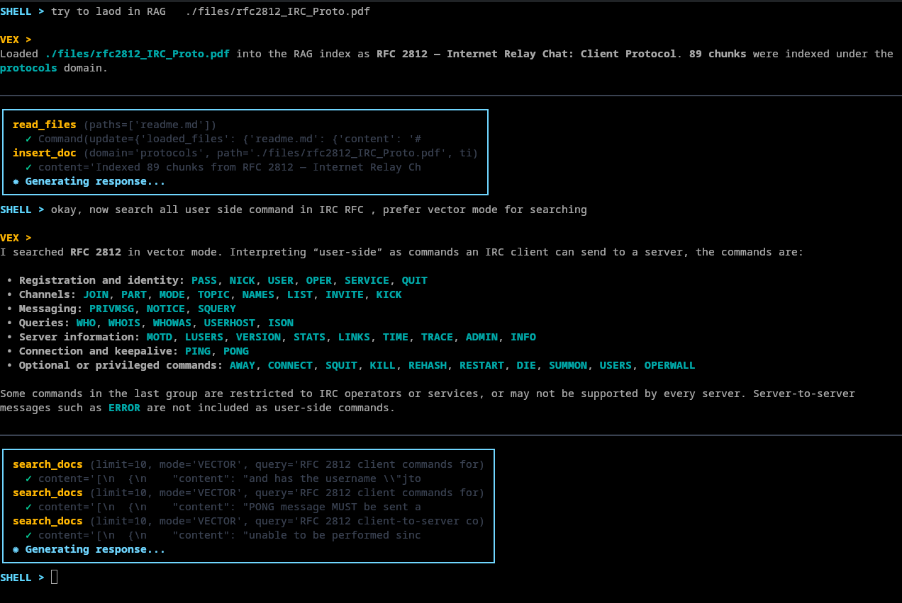

# Vex RAG MCP

*Local stdio MCP server for indexing files and searching with vector, BM25, or hybrid retrieval.*



## Requirements

- 384-dimensional `llama.cpp` embedding model (default search paths include `models/bge-small-en-v1.5.gguf`).
- SQLite with FTS5 and `sqlite-vec`.
- `pdftotext` for PDF ingestion.

Run from the project directory; relative paths use the working directory.

## Configuration

- `VEX_EMB_MODEL`: embedding model path. If unset, the server checks its [configured model paths](./src/llm.cpp#L13). A model is required at startup, including for BM25 searches.
- `VEX_RAG_DB`: database path. If unset, an existing `./.vex/session.db` is used; otherwise the server falls back to `./memory.db`. The database's parent directory must already exist.

## Tools

- `insert_doc`: indexes a file at `path` under `title` and `domain`. Replaces document on-conflict! Chunks are up to 200 words with 30-word overlap; PDFs are extracted with `pdftotext`.
- `search_docs`: searches `query` with specified `limit`(default 5). Available modes `HYBRID` (default), `VECTOR`, `BM25`. Each retrieval method considers up to 20 candidates.
- `delete_doc` Deletes document from RAG database by its title.
- `list_docs` Returns list of indexed documents in RAG database.

## Installation

```bash
curl -sSL https://codeberg.org/Enji/vex-rag/raw/branch/main/install.sh | sh
```

## Usage examples

The server communicates over standard input/output using one JSON-RPC request per line. Send these requests to the running server process.

Initialize and list available tools:

```json
{"jsonrpc":"2.0","id":1,"method":"initialize","params":{"protocolVersion":"2024-11-05","capabilities":{},"clientInfo":{"name":"example-client","version":"1.0"}}}
{"jsonrpc":"2.0","id":2,"method":"tools/list"}
```

List documents

```json
{"jsonrpc":"2.0","id":5,"method":"tools/call","params":{"name":"list_docs"}}
```
 
Index a PDF (replace the path with a file accessible to the server process):

```json
{"jsonrpc":"2.0","id":3,"method":"tools/call","params":{"name":"insert_doc","arguments":{"title":"rfc2812_IRC_Proto.pdf","path":"./files/rfc2812_IRC_Proto.pdf","domain":"software"}}}
```

Search with BM25:

```json
{"jsonrpc":"2.0","id":4,"method":"tools/call","params":{"name":"search_docs","arguments":{"query":"what does WHOIS command","limit":5,"mode":"BM25"}}}
```

Search with vector retrieval:

```json
{"jsonrpc":"2.0","id":5,"method":"tools/call","params":{"name":"search_docs","arguments":{"query":"what does WHOIS command","limit":5,"mode":"VECTOR"}}}
```

Delete document

```json
{"jsonrpc":"2.0","id":5,"method":"tools/call","params":{"name":"delete_doc","arguments":{"title":"RFC 2812 — Internet Relay Chat: Client Protocol"}}}
```